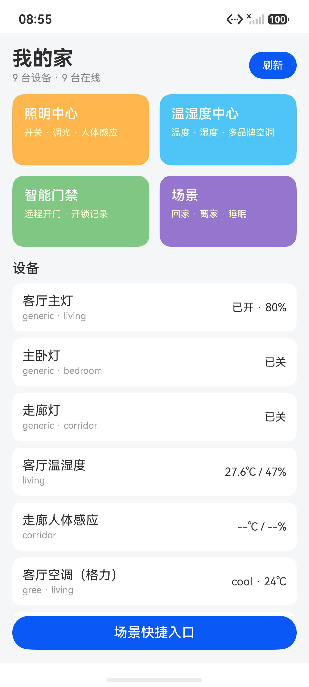
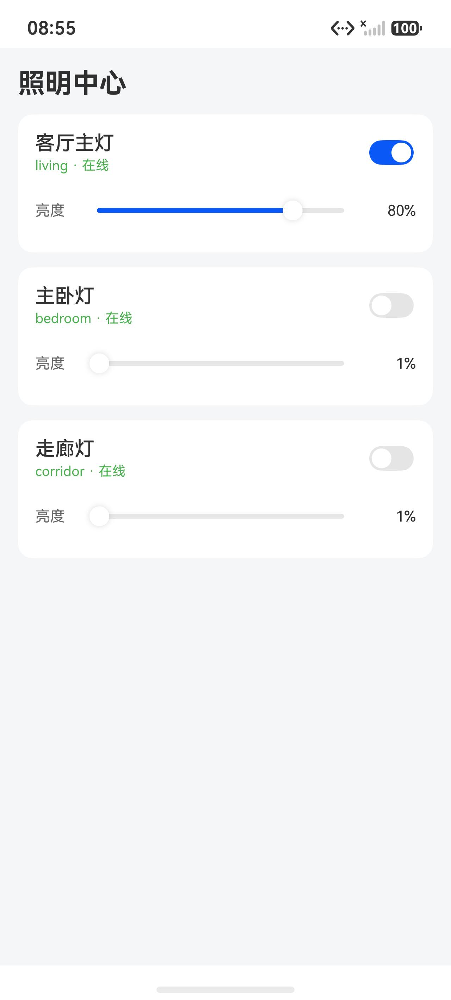
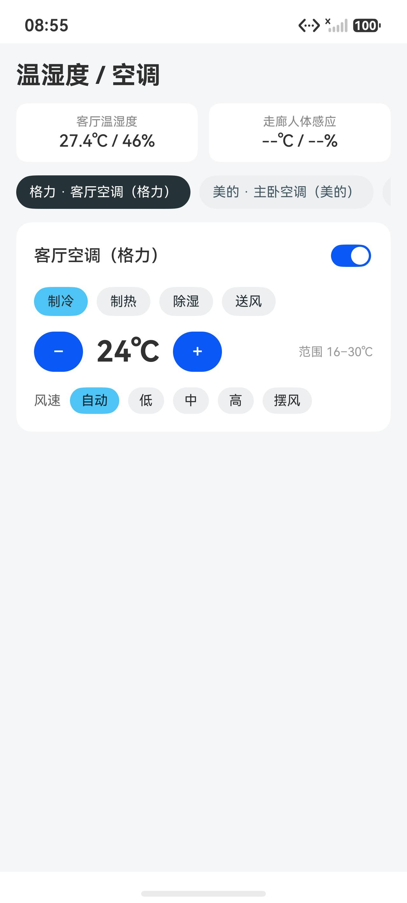
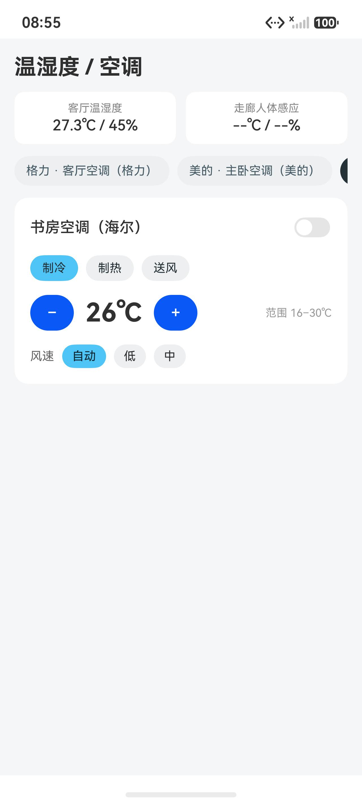
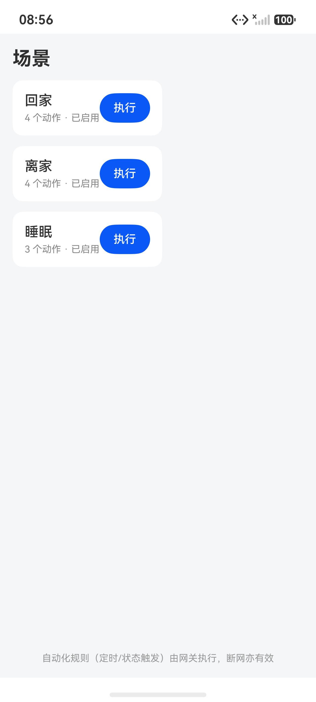
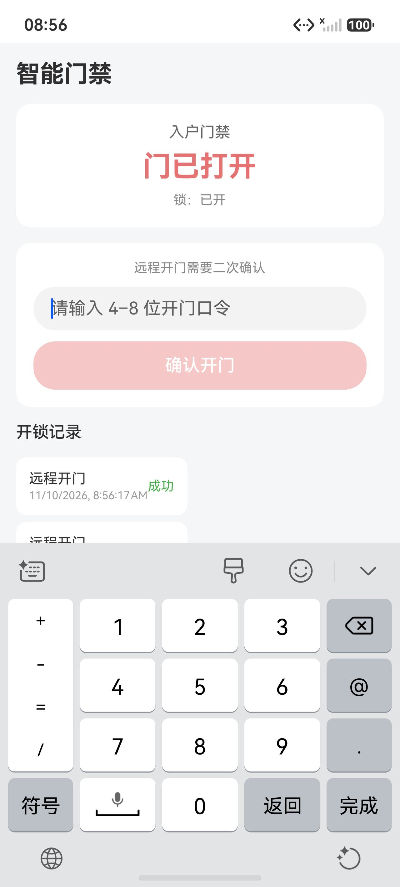

# 使用手册

**产品名称：** 家居设备控制系统（基于 OpenHarmony）
**文档编号：** MAN-HOME-OH-001
**版本：** V1.0
**编写日期：** 2026-11-01

---

## 1. 产品概述

本产品由两部分组成：

| 组成 | 运行载体 | 作用 |
|---|---|---|
| **网关端** | 国产主板（OpenHarmony 开发板） | 常驻运行：接入设备、执行场景与自动化、本地存储、对外提供加密服务 |
| **移动端** | HarmonyOS 手机 / 平板（HAP） | 用户交互：远程查看与控制、接收告警 |

特点：**本地执行、断网可用**；手机与网关之间的通信**三层加密**；**同一界面控制不同品牌空调**。

---

## 2. 硬件清单

### 2.1 必需

| 设备 | 说明 | 参考配置 |
|---|---|---|
| 国产主板 | 运行 OpenHarmony 的网关载体 | RK3568 类开发板，≥ 2 GB RAM / ≥ 8 GB 存储，带触屏更佳 |
| 网络 | 局域网 | 有线以太网或 Wi-Fi，网关与手机同一网段 |
| 电源 | 持续供电 | 5V/2A 以上，建议配 UPS 或防断电措施 |

### 2.2 可选（按演示需要）

| 设备 | 用途 | 备注 |
|---|---|---|
| 温湿度传感器 | 温湿度中心数据源 | 支持 MQTT 上报即可，或经 GPIO |
| 人体感应 + 光照传感器 | 照明自动亮灯 | 需同时上报 `motion` 与 `illuminance` |
| 灯具 / 灯带 | 照明中心执行对象 | 具备 `switch` / `brightness` 能力 |
| 空调（格力/美的/海尔） | 温湿度中心执行对象 | 三条接入路径见 5.2 |
| 红外发射模块 | 控制格力等红外空调 | 最常见、无需厂商授权 |
| 门禁执行机构 | 门禁中心 | 电磁锁或舵机，经 GPIO/串口驱动 |

> **无硬件也能完整演示**：网关内置仿真驱动，自带一套"三室两厅 + 三品牌空调 + 门锁"的虚拟家庭。

---

## 3. 部署

### 3.1 方式一：零硬件演示（推荐首次体验）

已在开发机上装好 Node.js ≥ 20 时：

```bash
# 启动网关（含内置 MQTT Broker 与仿真设备）
node gateway/main.mjs --broker --mqtt

# 另开一个终端，跑完整演示脚本（自动走完四大中心）
node scripts/demo.mjs
```

启动成功会打印：

```
  家居设备控制系统 · OpenHarmony 网关
  设备 12 台 / 区域 5 个 / 适配器 3 个
  WebSocket : ws://127.0.0.1:8765  MQTT: 1883
  账户      : admin/admin12345 · member/member12345 · guest/guest12345
```

### 3.2 方式二：真实 MQTT 设备联调

```bash
# 1) 启动网关（不自带 broker，连接你的 Mosquitto）
node gateway/main.mjs --mqtt --broker-port 1883

# 2) 或启动一台"虚拟设备"验证链路
node simulators/run.mjs --port 1883
```

### 3.3 方式三：开发板部署

1. 用 DevEco Studio 打开 `mobile/`，配置签名后编译出 HAP；
2. 将网关代码部署到开发板（Node 运行时或移植为 ArkTS 服务）；
3. 确保开发板与手机在同一局域网，记下开发板 IP；
4. 手机安装 HAP，在登录页填写 `开发板IP:8765`。

> 生产部署**必须启用 TLS**：在网关配置中提供证书与私钥（`services/ws.mjs` 的 `tls` 选项），
> 并使用 `wss://` 连接，避免明文链路。

---

## 4. 首次配置

### 4.1 登录

打开 App → 输入网关地址与端口 → 输入账户口令 → 「连接并登录」。

| 账户 | 口令（首次启动自动创建） | 权限 |
|---|---|---|
| admin | admin12345 | 全部（含添加/删除设备、改配置） |
| member | member12345 | 控制设备、执行场景，不能改配置 |
| guest | guest12345 | 只读，不能控制、不能开门 |

> **安全提示：** 上线前请立刻修改这三个默认口令，并修改门禁 PIN（见 6.2）。

### 4.2 添加设备

设备通电并在同一网络后，会向 `home/discovery/<设备ID>` 宣告自己，网关自动接入并在首页出现。
若未出现，检查：设备是否连上 Broker、Broker 地址是否正确、设备是否按 5.1 的主题格式上报。

---

## 5. 功能操作

### 5.1 首页

按区域展示设备卡片，顶部显示总台数与在线数；状态变化由网关主动推送，无需手动刷新。

### 5.2 温湿度 / 空调

1. 顶部查看各房间温度、湿度；
2. 横滑选择要控制的空调（标签显示品牌，如「格力 · 客厅空调」）；
3. 开关、模式、温度、风速、摆风按该品牌能力置灰显示——**灰色即该机型不支持**；
4. 温湿度超过阈值时，网关会自动开空调（制冷/除湿），并有冷却时间防止频繁动作。

**三个品牌的接入路径：**

| 品牌 | 推荐路径 | 说明 |
|---|---|---|
| 格力 | 红外码库 | 成本最低，无需授权；用实测码替换示例码 |
| 美的 | 厂商开放 API | 需账号授权；无授权时可用红外替代 |
| 海尔 | Modbus/通用网关 | 需支持 Modbus TCP 的网关设备 |

### 5.3 照明

- 开关：点卡片右侧开关；
- 亮度：拖动滑条，**松手才下发**（避免拖动过程刷屏）；
- 人体感应：进入感应区域且环境光低于 50 lux 时自动点亮，夜间以 10% 亮度；无人 2 分钟后自动关闭。

### 5.4 智能门禁

1. 页面顶部显示门与锁的实时状态；
2. 输入开门口令（默认 `2468`）→ 点「确认开门」；
3. 开门成功后自动上锁（默认 60 秒），并生成一条开锁记录；
4. 门未关超过 60 秒会触发告警推送。

> 开门必须二次确认，且访客角色无法开门——这是设计上的硬约束，不是限制。

### 5.5 场景

一键执行「回家 / 离家 / 睡眠」。场景由网关本地执行，**断网仍有效**；执行结果逐条返回，失败项会提示。

---

## 6. 运维与安全

### 6.1 系统自检

App 设置页（或 `ops.selfCheck` 接口）可一键检查：设备在线数、驱动加载、品牌适配器、密钥库状态、离线设备。

### 6.2 修改门禁 PIN

```javascript
app.access.setPin('135790');   // 4–8 位数字
```

### 6.3 轮换数据密钥

```javascript
app.keystore.rotate();         // 生成新版本，旧数据仍可解密
```

### 6.4 备份

密钥库文件（`.runtime/keys.json`）**不可明文外传**；配置备份请通过 `ops` 接口导出，不要直接拷贝数据库。

---

## 7. 故障排查

| 现象 | 可能原因 | 处理 |
|---|---|---|
| App 提示"连接失败" | 网关未启动 / IP 或端口错 / 防火墙 | 先确认 `ws://IP:8765` 可达；检查网关日志 |
| 提示"密钥协商超时" | 网关进程异常或版本不匹配 | 查看网关日志中 `ws server listening` 一行 |
| 登录提示"账户已锁定" | 连续 5 次口令错误 | 等待 5 分钟，或重启网关重置（仅演示环境） |
| 设备一直"离线" | 设备未连上 Broker、主题不对 | 用 MQTT 客户端订阅 `home/+/state` 观察是否有上报 |
| 控制返回"设备离线" | 心跳超时或 LWT 已置离线 | 检查设备供电与网络 |
| 控制返回"不支持该能力" | 设备能力集不含该项 | 查看设备详情页展示的能力；说明书中的能力表 |
| 空调模式点不动（灰色） | 该品牌不支持此模式 | 正常现象，见 5.2 品牌能力表 |
| 开门提示"口令错误" | PIN 不匹配 | 默认 `2468`，或按 6.2 重置 |

---

## 8. 常见问题

**Q：断网后还能用吗？**
A：能。控制、场景、定时都在网关本地执行；断网只影响手机远程访问。

**Q：换一个品牌空调要改 App 吗？**
A：不用。新增品牌只需实现一个适配器（`gateway/adapters/ac-<brand>/adapter.mjs`）并注册，界面自动按能力子集置灰。

**Q：数据存在哪里？会上传云端吗？**
A：全部在网关本地（内存 + 本地数据库），不上传云端。

**Q：能不能用网页控制？**
A：协议与传输层无关，Web 端只需实现同样的 WebSocket + 信封协议即可复用同一套 API。

---

## 9. 界面实录（HarmonyOS 模拟器实拍）

以下截图由 `scripts/emu-tour.ps1` 在官方模拟器（OpenHarmony-7.0.0.105 / API 26）上自动驱动产生，
不是设计稿：每一步都是真实的加密请求 → 网关 → 设备 → 状态回流的闭环。

### 9.1 首页



九个设备、五个区域，四张中心卡片；底部是设备总览，状态随推送自动刷新。

### 9.2 照明中心



客厅主灯已开、亮度 80%；勾选状态来自设备真实回报，不是本地假象。

控制后回到首页，摘要同步更新：


### 9.3 温湿度 / 空调：同一套界面，不同品牌能力子集

格力（4 种模式、4 档风速、支持摆风）：



海尔（3 种模式、3 档风速，**没有摆风**——界面直接不出现该按钮）：



### 9.4 场景



### 9.5 智能门禁

远程开门必须输入 4–8 位 PIN 二次确认，成功后门状态与开锁记录同时更新：



### 9.6 在模拟器上复现这套截图

```powershell
node gateway/main.mjs --host 0.0.0.0                       # 终端 1：网关
powershell -ExecutionPolicy Bypass -File scripts/emu.ps1        # 终端 2：装包 + 登录
powershell -ExecutionPolicy Bypass -File scripts/emu-tour.ps1   # 终端 2：巡演 + 截图
```

截图输出到 `C:\hcb\shots\`。脚本按控件文本定位，改版式不影响复现。

